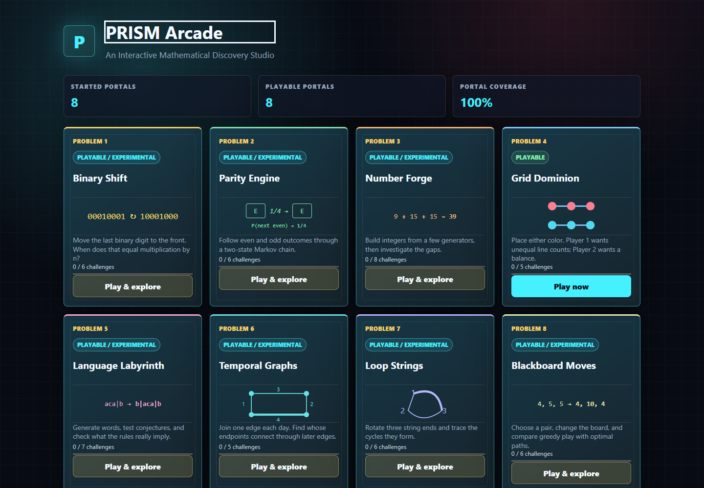
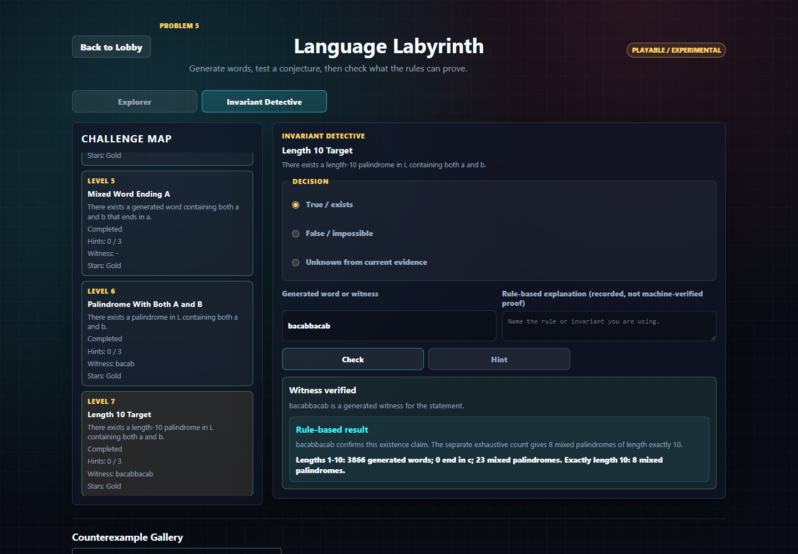
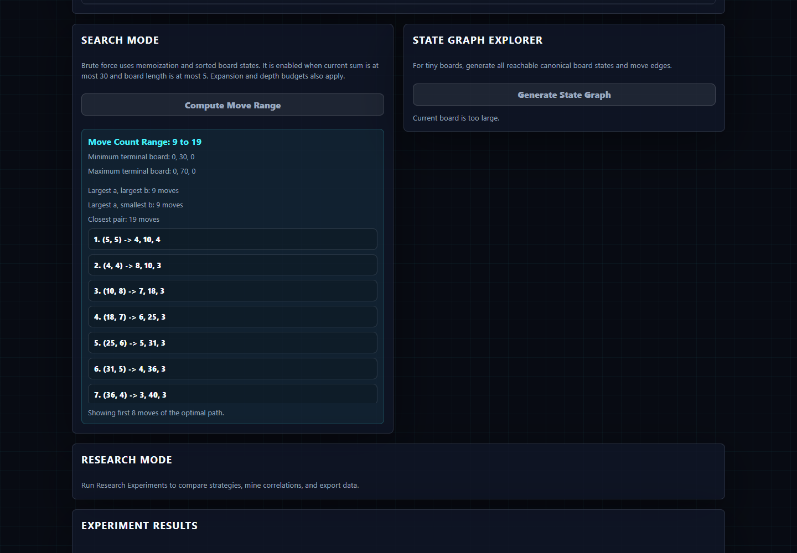
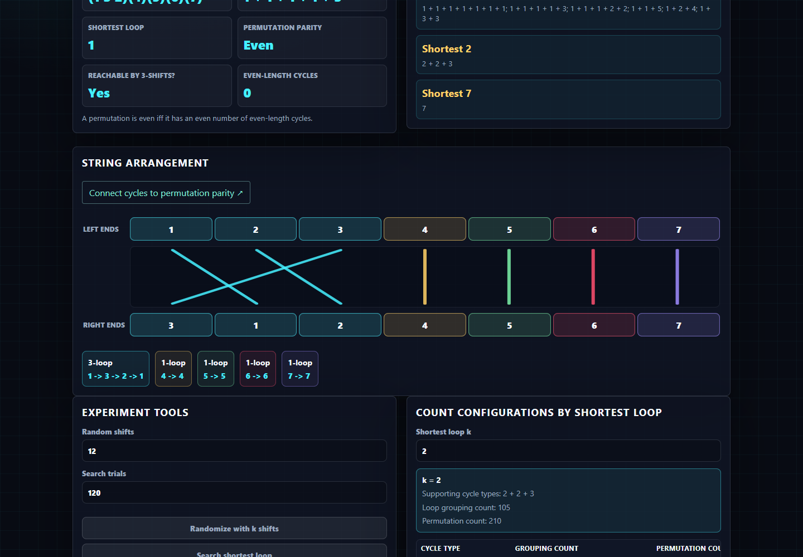

# PRISM Arcade

PRISM Arcade turns eight PRISM India problems into interactive mathematical experiments. Explore binary rotations, probability, graph games and formal languages; test conjectures, inspect counterexamples and follow the reasoning behind the results.

**Live demo:** [Play all eight PRISM Arcade portals](https://prism-arcade-live.vercel.app/).

## My role and development process

I began by investigating the PRISM India problems on paper, developing solutions, conjectures and proof attempts. Those investigations shaped the direction and mathematical purpose of the interactive games and experiments. The software gave me a way to explore strategies, test examples and examine counterexamples.

I used AI tools, including Codex, for software implementation, debugging, later mathematical verification and editorial preparation. The notebooks retain my historical claims, including mistakes; later verification and corrections are documented separately. See [provenance](docs/provenance.md) for the attribution and source history.

In Language Labyrinth, my original conclusion was incorrect. Later computational investigation and verification established that exactly eight generated palindromes of length 10 contain both `a` and `b`. This is a finite counting result, not a classification of all generated palindromes. The [correction dossier](docs/corrections/language-labyrinth.md) explains the counterexamples and the verification.

## Preview

| Eight playable portals | A verified Language Labyrinth witness |
| --- | --- |
| [](docs/media/lobby.png) | [](docs/media/language.png) |
| Blackboard: greedy versus optimal | Loop Strings: permutations and cycles |
| [](docs/media/blackboard.png) | [](docs/media/loops.png) |

These are actual application captures, not reconstructed gameplay.

## The Portals

| Problem | Environment | Mathematical focus |
| --- | --- | --- |
| 1 | Binary Shift | Binary rotation, divisibility and bounded search |
| 2 | Parity Engine | Markov probabilities and simulation |
| 3 | Number Forge | Reachability, gaps and certified reductions |
| 4 | Grid Dominion | Adversarial play, symmetry and edge balance |
| 5 | Language Labyrinth | Generated words, witnesses and invariant challenges |
| 6 | Temporal Graphs | Later-edge paths and newly winning owners |
| 7 | Loop Strings | Endpoint rotations, permutation parity and cycles |
| 8 | Blackboard Moves | Legal replay, greedy strategies and exact search |

All eight are playable. Portal coverage is 100%; personal challenge completion is tracked separately. Experimental modes and bounded or heuristic results remain labeled.

## Exploration and Research

Seven public notebook editions preserve 72 source-page positions. Statement omissions and new editorial context are labeled; the authenticated originals remain private. Seven solution editions retain the historical mathematics, including mistakes. Problem 8 has no supplied notebook or completed historical manuscript.

The approved research editions are hosted separately on Vercel Blob and integrated into the [live Research Journey](https://prism-arcade-live.vercel.app/). All 87 hosted files were independently checked against the pinned manifest. This repository contains code and lightweight metadata; the 187 MiB research payload stays outside Git and the application deployment. Source-only builds retain availability notices. See [research delivery](docs/research-availability.md).

### Follow a problem from notebook to game

The [Research Journey](https://prism-arcade-live.vercel.app/) lets you compare edited public editions of my earlier mathematical notes with the experiments they informed. A few examples are easiest to trace directly:

- **Grid Dominion:** My [earlier notebook](https://lhxs4gvzybfjtuwr.public.blob.vercel-storage.com/research/v1/problem-4-notebook.pdf) and [solution](https://lhxs4gvzybfjtuwr.public.blob.vercel-storage.com/research/v1/problem-4-solution.tex) explore 180° rotation, opposite-color pairings, and edge balance. Compare the [edge-counting rules](src/games/gridDominion/logic.js), [playable game](https://prism-arcade-live.vercel.app/#grid-dominion), and [independent bounded search checks](test/gridDominionOracle.test.js). The Hard AI search is a later software feature.
- **Number Forge:** The [original solution](https://lhxs4gvzybfjtuwr.public.blob.vercel-storage.com/research/v1/problem-3-solution.tex) works through residues modulo 3 for (9, 15, 25) and (9, 21, 49). The [reachability engine](src/games/numberForge/logic.js) and [tests](test/numberForge.test.js) explore these ideas. A [later correction](docs/corrections/number-forge.md) concerns a generalized software reduction, **not** an error in the original named-case work.
- **Language Labyrinth:** [Notebook page 15](https://lhxs4gvzybfjtuwr.public.blob.vercel-storage.com/research/v1/pages/language-labyrinth-15.webp) preserves my mistaken zero-answer argument. The [word generator](src/games/languageLabyrinth/logic.js) makes counterexamples testable; the [correction](docs/corrections/language-labyrinth.md) explains the later verification that exactly eight mixed palindromes have length 10.
- **Temporal Graphs:** [Notebook page 7](https://lhxs4gvzybfjtuwr.public.blob.vercel-storage.com/research/v1/pages/temporal-graphs-7.webp) records the ladder investigation. The [edge-trigger analysis](src/games/temporalGraphs/logic.js) distinguishes owners who win for the first time from those who already won; the [later correction](docs/corrections/temporal-graphs.md) explains the reverse-forest argument.

The original notes remain separate from subsequent corrections. Earlier software development took place in a private working repository in June 2026; this public repository is a later curated release.

## Implementation

React and Vite provide the interface. Pure JavaScript mathematical engines, bounded worker searches and independent regression oracles support the experiments. Local profiles, achievements and versioned save exports require no account service, analytics backend or leaderboard.

## Run Locally

Use Node.js 22.12 or newer:

```sh
npm ci
npm run dev -- --host 127.0.0.1
```

Open the URL Vite prints. On Windows, use `npm.cmd` if PowerShell blocks `npm.ps1`.

## Test and Build

```sh
npm test
npm run test:math
npm run test:save
npm run verify:content
npm run build
npm run preview -- --host 127.0.0.1 --port 4175 --strictPort
```

With the production preview running, use `npm run smoke` and `npm run smoke:research`. [Verification](docs/verification.md) covers browser setup, research-edition checks and reproducibility.

See [architecture](docs/architecture.md), [mathematical scope](docs/mathematics.md), [provenance](docs/provenance.md) and [limitations](docs/limitations.md). A finite search is not an unbounded proof; a heuristic is not perfect play; a written explanation is not automatically machine-verified.

## Credits and Rights

The source problems are from [PRISM India](https://www.prism-india.org/). This is an independent project, without organizer endorsement. The complete official problem-set PDF and excluded statement material are not distributed.

Software rights held by Radhe Dhoundiyal are released under the [MIT License](LICENSE), subject to the [license scope](docs/licensing.md). Research documents and preview media have separately reserved rights, not a blanket MIT grant. See [research rights](RESEARCH_NOTICE.md) and [third-party notices](THIRD_PARTY_NOTICES.md). PRISM India's statements and organizer diagrams are not licensed through this project.
