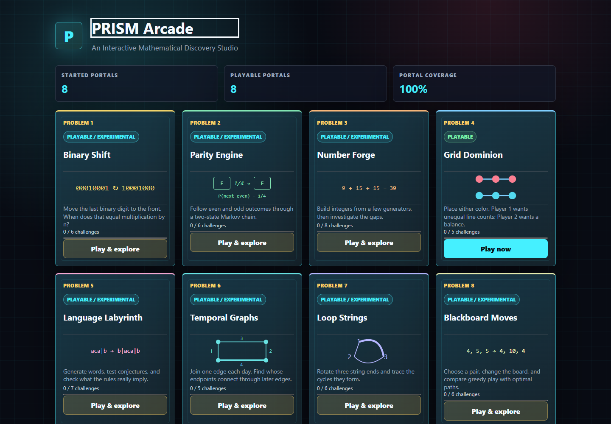
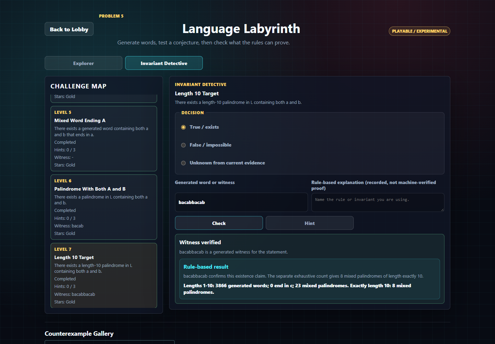
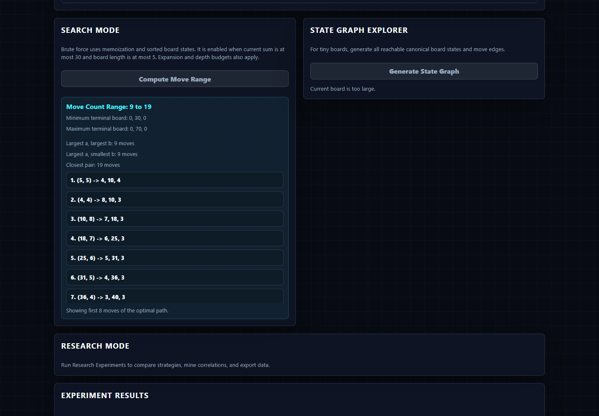
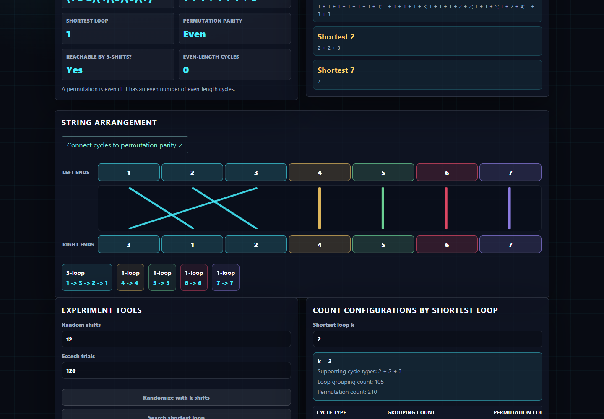

# PRISM Arcade

PRISM Arcade turns eight PRISM India problems into interactive mathematical experiments. Explore binary rotations, probability, graph games and formal languages; test conjectures, inspect counterexamples and follow the reasoning behind the results.

## Preview

| Eight playable portals | A verified Language Labyrinth witness |
| --- | --- |
| [](docs/media/lobby.png) | [](docs/media/language.png) |
| Blackboard: greedy versus optimal | Loop Strings: permutations and cycles |
| [](docs/media/blackboard.png) | [](docs/media/loops.png) |

These are actual application captures, not reconstructed gameplay.

## The Portals

| Problem | Environment | Mathematical focus |
| --- | --- | --- |
| 1 | Binary Shift | Binary rotation, divisibility and bounded search |
| 2 | Parity Engine | Markov probabilities and simulation |
| 3 | Number Forge | Reachability, gaps and certified reductions |
| 4 | Grid Dominion | Adversarial play, symmetry and edge balance |
| 5 | Language Labyrinth | Generated words, witnesses and invariant challenges |
| 6 | Temporal Graphs | Later-edge paths and newly winning owners |
| 7 | Loop Strings | Endpoint rotations, permutation parity and cycles |
| 8 | Blackboard Moves | Legal replay, greedy strategies and exact search |

All eight are playable. Portal coverage is 100%; personal challenge completion is tracked separately. Experimental modes and bounded or heuristic results remain labeled.

## Exploration and Research

Seven public notebook editions preserve 72 source-page positions. Statement omissions and new editorial context are labeled; the authenticated originals remain private. Seven solution editions retain the historical mathematics, including mistakes. Problem 8 has no supplied notebook or completed historical manuscript.

The research editions are prepared separately and are not yet publicly hosted. Their hash-verified asset package is not included in this repository. The source-only application shows meaningful availability notices; it does not provide live notebook downloads. Future research hosting is a separate step. See [research delivery](docs/research-availability.md).

Read the [Language Labyrinth](docs/corrections/language-labyrinth.md), [Temporal Graphs](docs/corrections/temporal-graphs.md) and [Number Forge](docs/corrections/number-forge.md) correction dossiers alongside the historical work, not as silent replacements for it.

## Implementation

React and Vite provide the interface. Pure JavaScript mathematical engines, bounded worker searches and independent regression oracles support the experiments. Local profiles, achievements and versioned save exports require no account service, analytics backend or leaderboard.

## Run Locally

Use Node.js 22.12 or newer:

```sh
npm ci
npm run dev -- --host 127.0.0.1
```

Open the URL Vite prints. On Windows, use `npm.cmd` if PowerShell blocks `npm.ps1`.

## Test and Build

```sh
npm test
npm run test:math
npm run test:save
npm run verify:content
npm run build
npm run preview -- --host 127.0.0.1 --port 4175 --strictPort
```

With the production preview running, use `npm run smoke` and `npm run smoke:research`. [Verification](docs/verification.md) covers browser setup, research-edition checks and reproducibility.

See [architecture](docs/architecture.md), [mathematical scope](docs/mathematics.md), [provenance](docs/provenance.md) and [limitations](docs/limitations.md). A finite search is not an unbounded proof; a heuristic is not perfect play; a written explanation is not automatically machine-verified.

## Credits and Rights

The source problems are from [PRISM India](https://www.prism-india.org/). This is an independent project, without organizer endorsement. The complete official problem-set PDF and excluded statement material are not distributed.

Software rights held by Radhe Dhoundiyal are released under the [MIT License](LICENSE), subject to the [license scope](docs/licensing.md). Research documents and preview media have separately reserved rights, not a blanket MIT grant. See [research rights](RESEARCH_NOTICE.md) and [third-party notices](THIRD_PARTY_NOTICES.md). PRISM India's statements and organizer diagrams are not licensed through this project.
